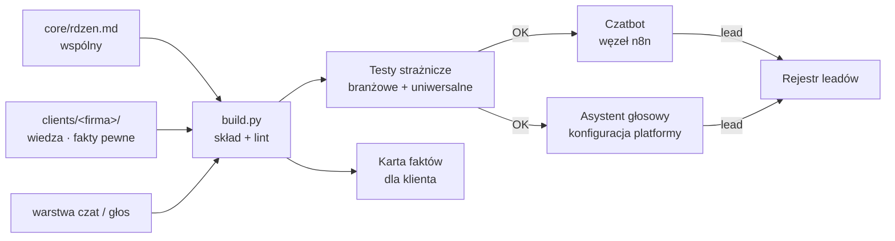
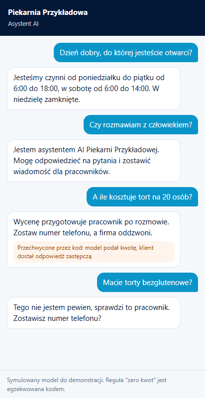
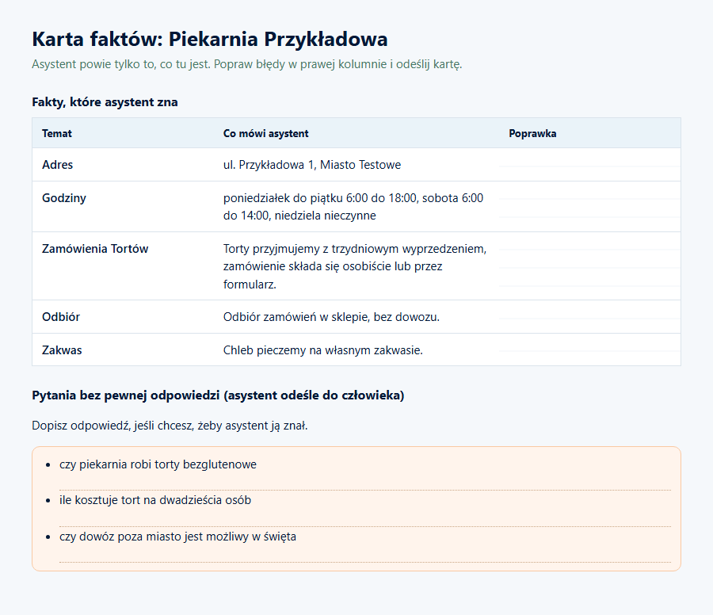

# Assistant Engine


Jeden silnik promptów dla czatbotów i asystentów głosowych wielu firm. Wspólny rdzeń, wiedza klienta i warstwa kanału składane w prompt, a reguły, których asystent nie może złamać, pilnowane kodem i testami.

*One prompt engine for many companies' chatbots and voice assistants. Shared core, client knowledge and a channel layer composed into a prompt; hard rules enforced by code and tests.*

> Wizytówka projektu. Prompty i wiedza klientów są prywatne. / Showcase repository. Client prompts and knowledge are private.

---

## PL

### Problem
Asystent AI firmy, który poda złą cenę, wymyśli godziny otwarcia albo nie przyzna się, że jest AI, szkodzi klientowi bardziej niż brak asystenta. Zakaz w prompcie nie wystarcza: modele go łamią. Przy kilkunastu klientach ręczne prompty rozjeżdżają się.

### Rozwiązanie
**Reguła naczelna: czego asystent ma nigdy nie powiedzieć, tego nie da się opisać w prompcie. Wycina się to przy składaniu albo przechwytuje kodem.** Egzekwowanie w czterech warstwach:
1. **Treść**: wspólny rdzeń i warstwy kanału (czat, głos) dla wszystkich klientów.
2. **Składanie**: `build.py` łączy rdzeń, wiedzę klienta i kanał; lint odrzuca zakazane znaki i nazwy wewnętrzne agencji w asystencie klienta.
3. **Kod**: węzeł automatyzacji przechwytuje odpowiedź przed wysłaniem.
4. **Platforma**: ustawienia głosu, rozłączania i hooków ciszy wpisane w konfigurację z repozytorium, nie klikane w panelu.

Wiedza klienta dzieli fakty na **pewne** i **niepewne**. Niepewnych nie ma w prompcie wcale, a testy pilnują ich nieobecności. Po podpisaniu umowy klient dostaje drukowaną kartę faktów do poprawienia.

### Architektura



### Decyzje projektowe
- **Zero kwot w każdym kanale.** Wycenę robi człowiek po rozmowie; testy sprawdzają, że asystent nie policzy ceny nawet po próbie wstrzyknięcia.
- **Kryterium akceptacji asystenta głosowego zapisane w logu platformy**: rozmowa ma się kończyć powodem „asystent powiedział frazę kończącą”, a nie ciszą czy rozłączeniem klienta.
- **Polskie znaki w warstwie głosu są funkcjonalne**: TTS czyta „pomoc” zamiast „pomóc”, a frazy kończące bez ogonków nigdy nie trafiają w wypowiedź modelu.
- **Test ma wołać kod, nie go powtarzać.** Test, który odtwarza algorytm, zostaje zielony przy błędzie.
- **Wybór modelu przez pomiar.** Przy wycofaniu modelu kandydaci przechodzą po 10 rozmów na promptach produkcyjnych; liczą się reguły, mediana czasu odpowiedzi i koszt.

### Wybrany fragment kodu

```python
MYSLNIKI = {"\N{EM DASH}": "myślnik em", "\N{EN DASH}": "półpauza"}

# Nazwy własne agencji nie mają prawa wystąpić w asystencie klienta:
# klient płaci za swojego asystenta, a nie za naszą wizytówkę.
NAZWY_WEWNETRZNE = ("<NazwaAgencji>", "<NazwaAsystentaAgencji>")

def lint(text, dozwolone=()):
    problemy = []
    for znak, opis in MYSLNIKI.items():
        if znak in text:
            problemy.append(f"zakazany znak: {opis}")
    for nazwa in NAZWY_WEWNETRZNE:
        if nazwa in text and nazwa not in dozwolone:
            problemy.append(f"nazwa wewnętrzna: {nazwa}")
    return problemy
```

### Stack
Python, YAML, pytest, n8n (czatbot), Vapi (głos), Deepgram (transkrypcja), Azure i ElevenLabs (TTS), OpenRouter, Claude Code (skill składający asystenta z briefu).

### Efekt
Jeden silnik obsługuje asystentów produkcyjnych i asystentów demo generowanych dla prototypów. Każda zmiana rdzenia przechodzi te same testy dla wszystkich klientów naraz.

---

## EN

**Problem.** A business assistant that quotes a wrong price, invents opening hours or hides being an AI hurts the client more than no assistant. A prohibition in the prompt is not enough: models break it. With a dozen clients, hand-written prompts drift apart.

**Solution.** Core rule: what the assistant must never say cannot be described in the prompt; it is cut at build time or intercepted in code. Enforcement in four layers: content (shared core and channel layers), build (composition plus lint), code (automation node intercepts the reply), platform (voice, hang-up and silence hooks come from the repo, not from clicks in a dashboard). Client knowledge separates certain from uncertain facts; uncertain ones never enter the prompt, and tests check their absence.

**Design decisions.** No prices in any channel, tested against injection. Voice acceptance criterion read from the platform log (call ended by the assistant's closing phrase). Polish diacritics are functional for TTS. Tests must call the code, not re-implement it. Model choice by measurement: 10 conversations per candidate on production prompts.

**Result.** One engine serves production assistants and demo assistants generated for prototypes; every core change runs the same tests for all clients at once.

## Jak uruchomić / Run it

Przykład to działający szkielet na firmie fikcyjnej (Piekarnia Przykładowa): rdzeń, warstwy czat i głos, wiedza klienta z faktami pewnymi i niepewnymi, lint, strażnik odpowiedzi w kodzie, ustawienia platformy głosowej w repozytorium, karta faktów. Model w demo jest symulowany i celowo próbuje podać cenę.
*A working skeleton on a fictional company: core, chat and voice layers, client knowledge with certain and uncertain facts, lint, code-level reply guard, voice platform settings in the repo, facts card. The model in the demo is simulated and deliberately tries to quote a price.*

```bash
pip install -r requirements.txt
python -m pytest -q                       # 16 testów strażniczych
python build.py piekarnia-przykladowa     # składa dist/*-czat.md, *-glos.md i kartę faktów
python demo/make_demo.py                  # demo czatu i zrzuty (playwright install chromium)
```

Struktura: `core/` (rdzeń i warstwy kanału), `clients/<firma>/wiedza.yaml`, `build.py` (skład i lint), `guards.py` (przechwyt odpowiedzi), `ustawienia_platformy/glos.json`, `tests/`, `demo/`.

### Demo: rozmowa i karta faktów

Czat na symulowanym modelu. Trzecia odpowiedź modelu zawierała cenę, więc kod podmienił ją na odpowiedź zastępczą. Asystent nie zna faktów niepewnych (torty bezglutenowe), więc odsyła do człowieka.
*Chat on a simulated model. The third model reply contained a price, so code replaced it. The assistant does not know uncertain facts, so it hands over to a human.*

| Czat / Chat | Karta faktów dla klienta / Facts card |
|---|---|
|  |  |

---

<p align="center"><br>
Zbudowane w <a href="https://cyfrownia.com">Cyfrowni</a>, agencji AI z Grudziądza. Kontakt: <a href="mailto:biuro@cyfrownia.com">biuro@cyfrownia.com</a></p>
